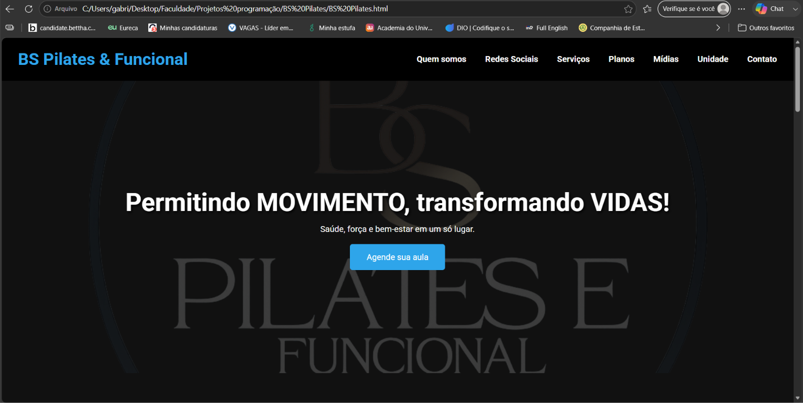

# 🧘 BS Pilates & Funcional

Projeto desenvolvido como estudo de HTML, CSS e JavaScript, simulando um site institucional para um estúdio de Pilates.

## 📷 Preview



## 🚀 Demonstração

Acesse o projeto:

https://github.com/gchamps/bspilates/tree/main

## 📌 Funcionalidades

- Layout moderno
- Design responsivo
- Menu fixo
- Scroll suave
- Seções institucionais
- Botão para WhatsApp

## 🛠️ Tecnologias

- HTML5
- CSS3
- JavaScript
- Git
- GitHub

## 📂 Estrutura

```
📦 BS PILATES
 ┣ 📂 assets
 ┣ 📂 css
 ┣ 📂 js
 ┣ 📜 index.html
 ┣ 📜 midias.md
 ┣ 📜 README.md
 ┗ 📜 LICENSE
```

## 🎯 Objetivo

Este projeto foi desenvolvido exclusivamente para estudo, praticando:

- Estruturação semântica em HTML
- Organização de arquivos
- CSS responsivo
- Navegação entre seções
- Publicação utilizando GitHub Pages

## 📈 Melhorias futuras

- [ ] Galeria de imagens
- [ ] Página de serviços
- [ ] Formulário de contato
- [ ] Integração com Google Maps
- [ ] Animações utilizando AOS
- [ ] Modo escuro

## 👨‍💻 Autor

Gabriel Champin

LinkedIn:
www.linkedin.com/in/gabrielchampin

GitHub:
https://github.com/gchamps
